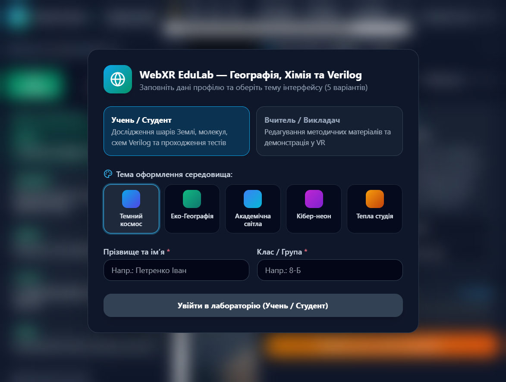

# WebXR EduLab

Інтерактивна навчальна лабораторія: географія, хімія та Verilog HDL. Учень або викладач входить у профіль, обирає предмет і працює з 3D-сценою, теорією та тестами. Для географії та хімії сцена побудована на Three.js, для Verilog — жива схема логічних вентилів.

## Запуск

Потрібні Node.js і npm.

```bash
npm install
npm start
```

Після збірки відкрийте [http://localhost:3000](http://localhost:3000).

На екрані входу вкажіть прізвище й ім’я (два слова) та клас або групу, оберіть тему оформлення і натисніть «Увійти в лабораторію». Далі відкрийте предмет: географію, хімію або Verilog.

## Екрани

Вхід у лабораторію: роль, тема інтерфейсу, ім’я та група.



Вибір предмета після входу. У географії 5 моделей і 14 запитань, у хімії — 5 моделей і 7 запитань, у Verilog — 6 схем і 10 запитань.


Географія. Ліворуч каталог моделей, у центрі 3D-сцена, праворуч теорія і перехід до тестів.


Хімія. Приклад — молекула води з описом структури та повзунком температури.


Verilog HDL. Логічний вентиль AND, входи A/B/C і поле коду `assign`.


## Що є в лабораторії

- **Географія** — розріз Землі, атмосфера, стратовулкан, рельєф, кліматичні пояси.
- **Хімія** — вода, вуглекислий газ, метан, бензол, кристалічна ґратка NaCl.
- **Verilog** — вентилі AND/OR/XOR/NAND, логічний ланцюг, півсуматор, мультиплексор, дешифратор, RS-тригер.
- Панель інструментів: обертання сцени, розріз, збірка, лінійка, каркас, сітка, п’ять тем інтерфейсу і кнопка WebXR.

## Стек

React, Three.js, Tailwind CSS, lucide-react. Збірка — Create React App (`react-scripts`).
